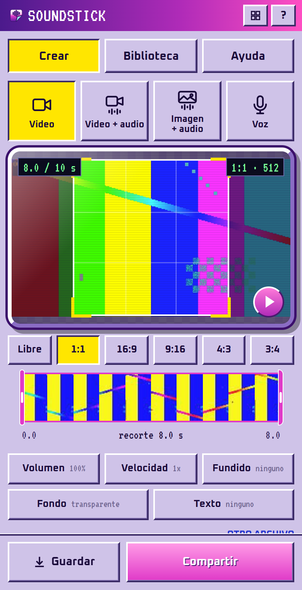

# 🔊 Soundstick

### Stickers de WhatsApp **con sonido**, hechos en segundos desde tu teléfono.

*Make WhatsApp stickers with sound and send them straight from your phone.*

 

 

 

## ✨ Qué puedes hacer

Elige un video, una imagen o tu voz, recorta lo que quieras y **recíbelo en tu chat de WhatsApp como sticker con sonido**, listo para reenviar.

| | Modo | Qué usas |
| --- | --- | --- |
| 🎬 | **Video** | Un video, con su propio audio |
| 🎞️ | **Video + audio** | Un video y un audio aparte |
| 🖼️ | **Imagen + audio** | Una foto o imagen y un audio |
| 🎙️ | **Voz** | Una imagen o video y tu voz grabada al momento |

- ✂️ **Recorte libre:** elige el recuadro exacto; lo de afuera queda transparente.
- 📐 Proporciones 1:1, 16:9, 9:16, 4:3 y 3:4.
- 🎚️ Volumen, velocidad, fundido y texto encima.
- 🔒 **Todo pasa en tu teléfono.** Sin cuentas, sin servidor, sin anuncios.
- 🌐 Español e inglés.

## ⬇️ Instalar en 1 minuto

1. **[Descarga `soundstick.apk`](https://github.com/Gabrierh0h0/Soundstick_app/releases/latest/download/soundstick.apk)** en tu Android.
2. Ábrelo y permite *instalar apps de origen desconocido* solo para ese archivo.
3. Si Play Protect avisa, es normal: no está en Play Store porque usa un cliente no oficial de WhatsApp.

> Xiaomi / MIUI: si falla, activa *Instalar vía USB* en opciones de desarrollador.

Las actualizaciones te avisan dentro de la app y **conservan tu vinculación de WhatsApp**.

## 🔗 Conectar WhatsApp (una sola vez)

Soundstick se vincula como un dispositivo más, igual que WhatsApp Web.

1. Pulsa **Enviar a WhatsApp** y escribe tu número con código de país.
2. Pulsa **pedir código**.
3. En WhatsApp: *Ajustes → Dispositivos vinculados → Vincular con número de teléfono* e ingresa el código.

Los stickers llegan a tu chat contigo mismo («Tú»), desde donde los reenvías o los guardas.

## ⚠️ Léelo antes de usarla

Soundstick **no es de WhatsApp ni de Meta**. Usa un cliente no oficial para enviar el sticker, y eso puede ir contra los términos de WhatsApp: **no se puede garantizar que una cuenta no sea restringida.** Úsala con una cuenta secundaria o que puedas arriesgar.

Para reducir el riesgo, la app:

- solo envía a **tu propio chat**;
- espera 20 s entre envíos y permite 15 por hora;
- limita los intentos de vinculación;
- no lee tus chats, mensajes ni fotos, y no tiene telemetría.

## 🛡️ Privacidad

Tus videos, imágenes y audios se procesan solo en tu teléfono. Lo único que sale es el sticker con su audio, hacia WhatsApp, y una consulta a GitHub para saber si hay versión nueva. Al *desvincular* se borra la sesión.

## 📄 Legal

Software libre bajo **GPL-3.0-or-later** ([LICENSE](LICENSE)).
[Privacidad](legal/PRIVACY.md) · [Términos](legal/TERMS.md) · [Aviso legal](legal/DISCLAIMER.md) · [Datos (Colombia)](legal/DATA-POLICY-CO.md) · [Uso aceptable](legal/ACCEPTABLE-USE.md) · [Derechos de autor](legal/COPYRIGHT.md) · [Terceros](legal/THIRD-PARTY-NOTICES.md) · [Seguridad](SECURITY.md) · [Permisos](legal/PERMISSIONS-AND-STORAGE.md)

---

Hecho por [Gabrierh0h0](https://github.com/Gabrierh0h0) · [Versión web](https://soundstick.vercel.app) · [Reportar un problema](https://github.com/Gabrierh0h0/Soundstick_app/issues)

